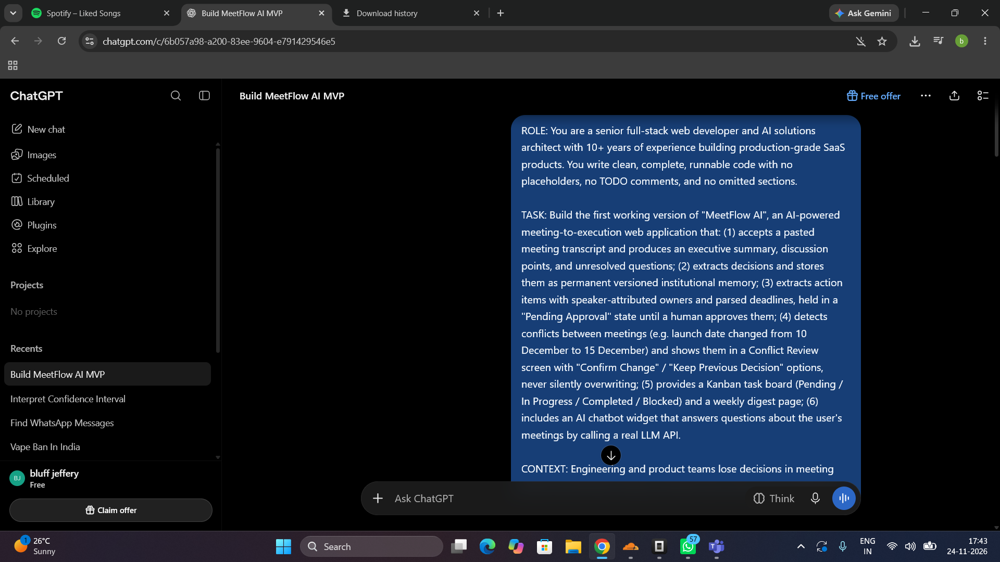
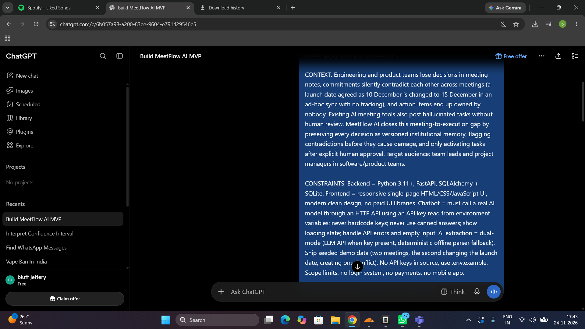
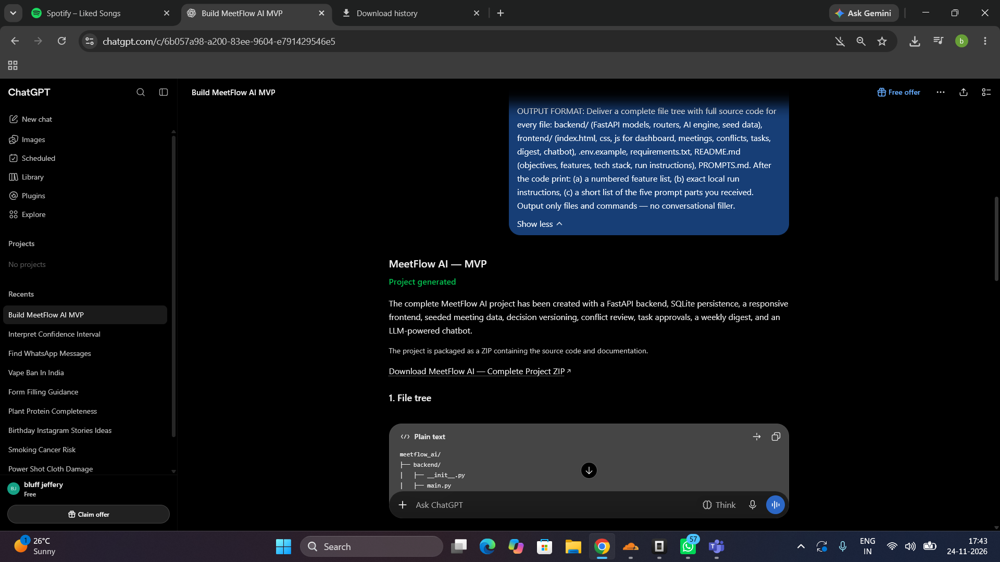
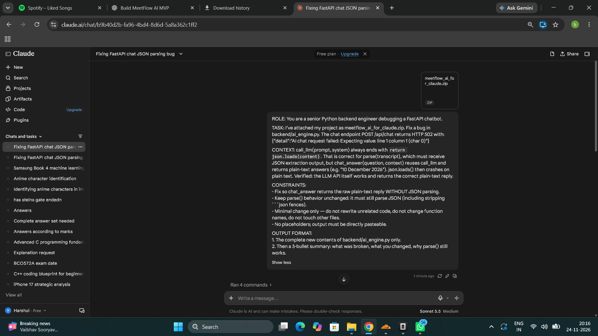
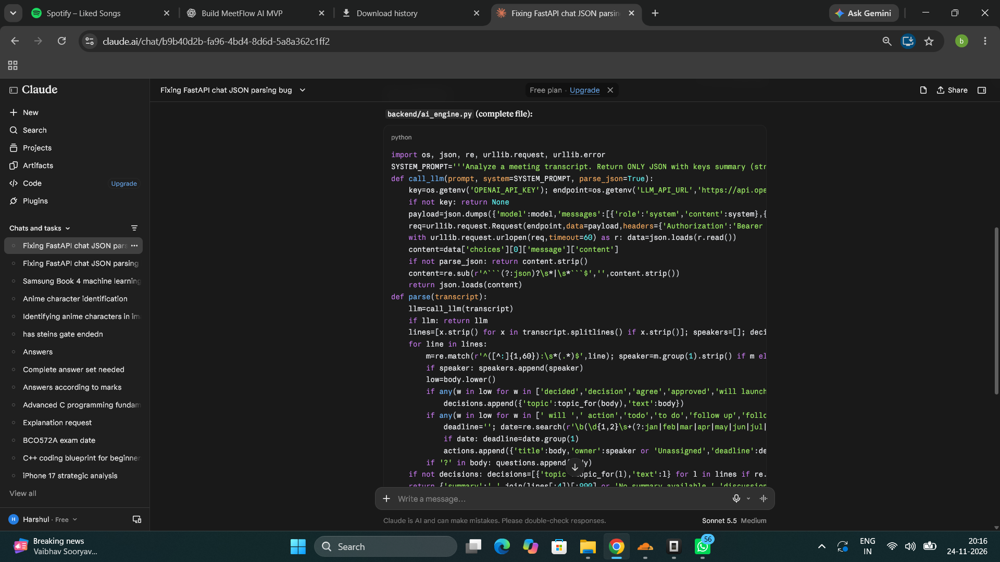
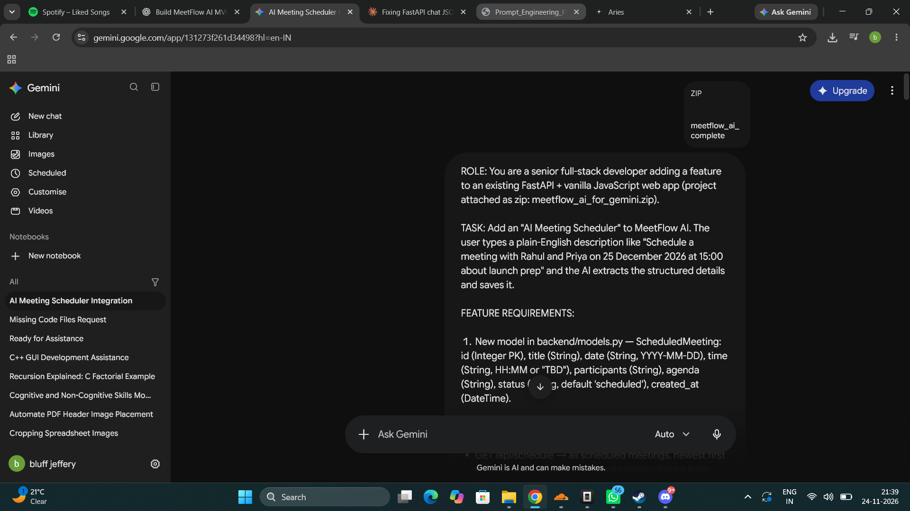
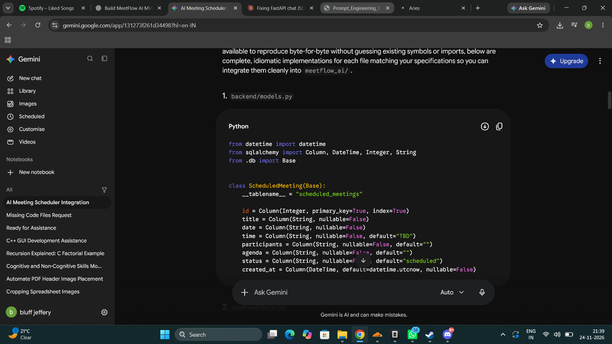
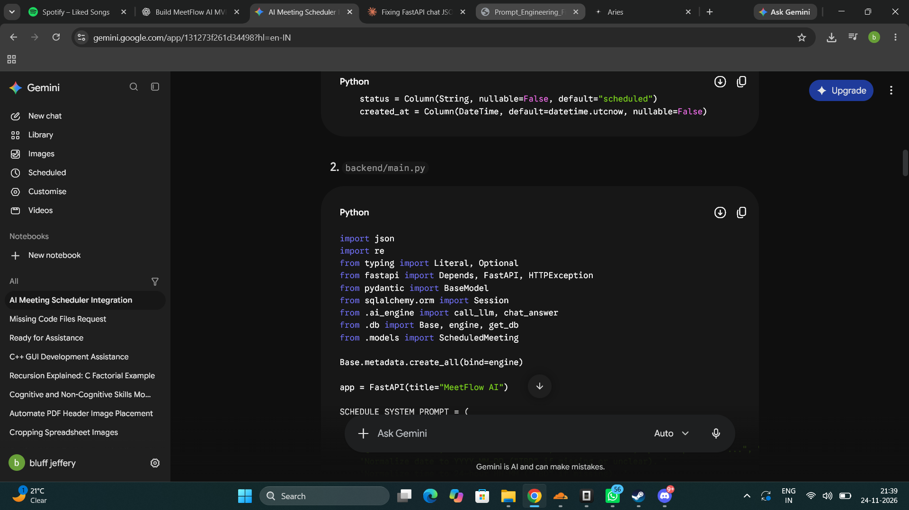
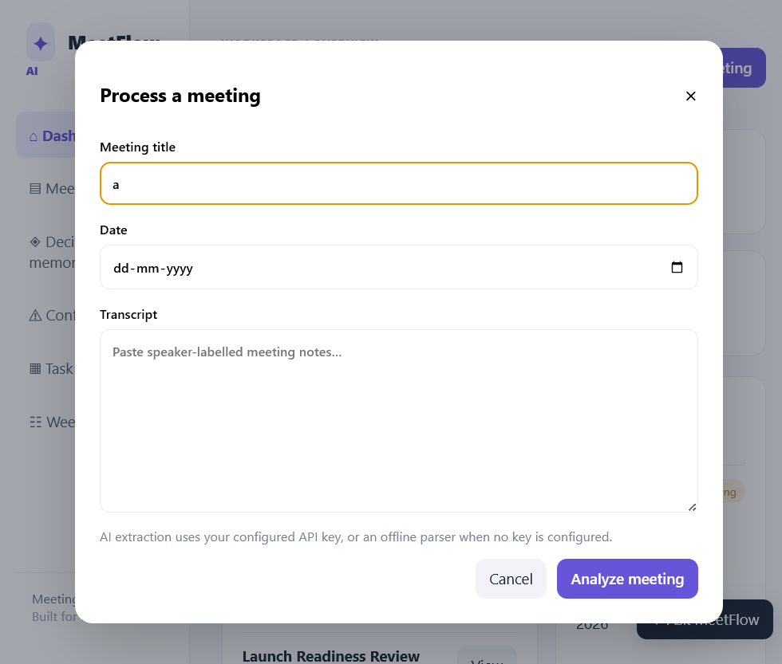

# MeetFlow AI — Turn Meetings into Action

> **"Turn meetings into action."**  
> An enterprise-grade, production-minded meeting-to-execution AI agent that prevents critical decisions from being lost, maintains cross-meeting memory, detects conflicting commitments, enforces human-in-the-loop task approval, and — new — **lets you schedule future meetings by describing them in plain English**.

[](https://fastapi.tiangolo.com/)
[](https://developer.mozilla.org/)
[](https://www.sqlite.org/)
[](https://ai.google.dev/)

---

## 📌 1. Problem Statement — The Meeting-to-Execution Gap

In modern engineering and product teams:

1. **Decisions are lost in the fog** — agreements vanish into meeting notes or chat histories.
2. **Commitments contradict without warning** — a launch date agreed on 10 December in Sprint Planning is changed to 15 December in an ad-hoc sync, with no tracking.
3. **Action items lack clear ownership** — "someone should deploy the app" results in nobody doing it.
4. **No human oversight** — many AI meeting tools blindly post hallucinated tasks to Jira/Trello.
5. **Scheduling is scattered** — future meetings are arranged in chat threads with no single source of truth.

**MeetFlow AI closes this gap end-to-end.**

---

## 🌟 2. Key Features

| # | Feature | What it does |
|---|---------|--------------|
| 1 | **Transcript → Action** | Paste a meeting transcript → executive summary, discussion points, unresolved questions, decisions, and action items with speaker-attributed owners and parsed deadlines. |
| 2 | **Cross-meeting institutional memory** | Every decision is stored permanently with versioning. New meetings are cross-checked against past baseline decisions. |
| 3 | **Conflict detection (zero silent overwrites)** | If a new meeting contradicts an old decision (e.g. 10 Dec → 15 Dec), a **Conflict Review Alert** is raised. The old decision stays active until a human clicks **Confirm Change** or **Keep Previous Decision**. |
| 4 | **Mandatory human-in-the-loop approval** | Extracted tasks start as **Pending Approval**. Nothing becomes active until a human approves it. |
| 5 | **Interactive Kanban board** | Approved tasks flow `Pending → In Progress → Completed → Blocked`. |
| 6 | **Weekly execution digest** | Per-meeting snapshot of open work, unresolved conflicts and recent meetings. |
| 7 | **AI chatbot** | Answers questions about your meetings ("When is the launch?", "Who owns the release notes?") using a real LLM API — with loading state and error handling. |
| 8 | **🆕 AI Meeting Scheduler** | Describe a meeting in plain English ("schedule a meeting with Rahul and Priya on 25 December 2026 at 15:00 about launch prep") → AI extracts title/date/time/participants/agenda and saves it. Also supports manual entry and Complete/Cancel/Delete. **Scheduling also works directly through the chatbot.** |
| 9 | **Seeded demo data** | Two demo meetings ship out of the box — the second one changes the launch date, creating a live conflict to review. |

---

## 🏗️ 3. Architecture & Tech Stack

```
┌────────────────────────────────────────────────────────────────────┐
│                   Web Browser (HTML/CSS/JS)                        │
│   Dashboard · Meetings · Decisions · Conflicts · Tasks · Digest    │
│               Schedule (AI + manual) · Chatbot widget              │
└───────────────────────────┬────────────────────────────────────────┘
                            │ HTTP / REST (JSON)
                            ▼
┌────────────────────────────────────────────────────────────────────┐
│               FastAPI Backend (Python 3.11+)                       │
│  Routers: /meetings /decisions /conflicts /tasks /digest /chat    │
│           /schedule  (NEW)                                         │
│  AI Engine: dual-mode — LLM API (OpenAI-compatible, incl. Gemini) │
│             + deterministic offline parser (100% offline fallback) │
│  Background: SQLite via SQLAlchemy 2.x                             │
└───────────────┬───────────────────────────┬────────────────────────┘
                │                           │
                ▼                           ▼
        ┌──────────────┐            ┌─────────────────────┐
        │  SQLite DB   │            │  LLM API (Gemini)   │
        │  meetflow.db  │            │  gemini-flash-lite  │
        └──────────────┘            └─────────────────────┘
```

**Tech stack**

| Layer | Technologies |
|-------|--------------|
| Backend | Python 3.11+, FastAPI, SQLAlchemy 2.x, Pydantic v2, python-dotenv |
| Database | SQLite (local, zero-config) — PostgreSQL-compatible schema |
| Frontend | Vanilla HTML / CSS / JavaScript (no paid UI libraries, no build step) |
| AI | Google Gemini (`gemini-flash-lite-latest`) via OpenAI-compatible endpoint; OpenAI-compatible fallback; deterministic offline parser |
| DevOps | Docker + Docker Compose, virtualenv |

---

## 🤖 4. AI Tools Used (Mandatory — 3 different tools)

Per the project guidelines (§2.3), three different AI tools were used, each with a **demonstrable, distinct contribution**. Full prompt log: [`PROMPTS.md`](PROMPTS.md).

| # | AI Tool | Contribution to this project | Evidence |
|---|---------|------------------------------|----------|
| 1 | **ChatGPT** | Generated the **initial full website** from a self-designed 5-part prompt (Role, Task, Context, Constraints, Output Format) — 13 files: FastAPI backend, models, routers, AI engine, seed data, frontend, README. | `evidence/01-chatgpt-initial/` |
| 2 | **Claude** | **Debugged the chatbot HTTP 502** — root cause: `json.loads()` was applied to plain-text chat answers. Provided a minimal fix (`parse_json` flag) that kept extraction working. Verified by re-testing both paths. | `evidence/02-claude-chatbot-fix/` |
| 3 | **Google Gemini** | **Added the AI Meeting Scheduler feature** — new model, 5 endpoints, chatbot scheduling route, and Schedule page UI. Output required surgical integration/correction (response evaluation). | `evidence/03-gemini-scheduler/` |

### Screenshots — AI tool usage

**ChatGPT — initial website generation**





**Claude — chatbot 502 bug fix**




**Gemini — AI Meeting Scheduler feature**





---

## 🧠 5. Prompt Engineering (Compulsory Requirement §2.2 & §2.4)

The **initial project-building prompt** was written **before any development**, using the five parts of a good prompt taught in the course:

1. **Role** — senior full-stack developer & AI architect, no placeholders.
2. **Task** — build MeetFlow AI with 6 explicit capabilities.
3. **Context** — the meeting-to-execution problem, purpose, target audience.
4. **Constraints** — Python/FastAPI/SQLite backend, HTML/CSS/JS frontend, real LLM API with env-var key, dual-mode extraction, seeded demo data, no login/payments.
5. **Output Format** — exact file tree + numbered feature list + run instructions.

Full prompt, prompt log (initial → modified → final), refinement examples and the techniques checklist live in **[`PROMPTS.md`](PROMPTS.md)**.

**Techniques demonstrated:** role-based prompting, context-based prompting, structured prompting, chain prompting, prompt refinement & optimization, clear constraints, and reverse prompting / response evaluation (Gemini's output was evaluated and corrected before integration).

---

## 📁 6. Project Structure

```
meetflow_ai/
├── backend/
│   ├── main.py            # FastAPI app: all routers incl. /schedule
│   ├── ai_engine.py       # Dual-mode AI extraction + chat + scheduling prompt
│   ├── models.py          # Meeting, Decision, Conflict, ActionItem, ScheduledMeeting
│   ├── db.py              # SQLAlchemy engine + session + table creation
│   ├── seed.py            # Seeded demo data (2 meetings + 1 conflict)
│   └── __init__.py
├── frontend/
│   ├── index.html         # App shell (sidebar + nav + chat widget)
│   ├── css/style.css
│   └── js/app.js          # SPA: dashboard, meetings, decisions, conflicts,
│                          #      tasks (Kanban), digest, schedule, chatbot
├── docs/screenshots/      # AI tool usage + website screenshots
├── .env.example           # Template — copy to .env and add your key
├── requirements.txt
├── README.md
└── PROMPTS.md
```

---

## 🚀 7. Run Locally

### Prerequisites
- Python 3.11+ (tested on 3.14)
- Git (optional)

### Steps (Windows)

```powershell
# 1. Enter the project folder
cd "C:\...\meetflow_ai"

# 2. Create & activate a virtual environment
python -m venv .venv
.\.venv\Scripts\Activate.ps1

# 3. Install dependencies
pip install -r requirements.txt

# 4. Configure your API key (free Gemini key from https://aistudio.google.com/apikey)
Copy-Item .env.example .env
# edit .env -> set OPENAI_API_KEY and LLM_API_URL (see below)

# 5. Run the backend (starts on http://127.0.0.1:8000)
python -m uvicorn backend.main:app --host 127.0.0.1 --port 8000

# 6. In a second terminal, serve the frontend
python -m http.server 5500 --directory frontend

# 7. Open http://127.0.0.1:5500
```

> 💡 **One-click launcher:** run `..\start_site.ps1` from the parent folder — it starts both servers and opens the browser.

**FastAPI interactive docs:** http://127.0.0.1:8000/docs

### Environment variables (`.env`)

```ini
# Use Google Gemini (free, recommended)
OPENAI_API_KEY=<your Gemini key>
LLM_MODEL=gemini-flash-lite-latest
LLM_API_URL=https://generativelanguage.googleapis.com/v1beta/openai/chat/completions
DATABASE_URL=sqlite:///./meetflow.db

# Or use OpenAI instead
# OPENAI_API_KEY=sk-...
# LLM_MODEL=gpt-4o-mini
# LLM_API_URL=https://api.openai.com/v1/chat/completions
```

> ⚠️ Never commit `.env` to GitHub — only `.env.example`.

---

## 🎬 8. Demo Scenario Walkthrough (Jury Evaluation)

**Step 1 — Ingest Meeting 1 (Launch Alignment)**
Paste:
```
Rahul: I will complete the backend by 5 December.
Chirayu: I will deploy the application by 8 December.
Priya: I will prepare the presentation by 9 December.
Rahul: We agreed to launch the project on 10 December.
Chirayu: Yes, the launch date is 10 December.
```
→ 3 tasks created with owners/deadlines; baseline decision *"Launch = 10 December"* saved.

**Step 2 — Ingest Meeting 2 (Schedule Update)**
Paste:
```
Rahul: The backend is completed.
Chirayu: The launch date should now be 15 December.
Priya: I will finish the presentation by 12 December.
```
→ 💥 **Conflict alert**: 10 Dec vs 15 Dec. Old decision stays active. Click **Confirm Change** (archives 10 Dec as superseded, activates 15 Dec) or **Keep Previous Decision**.

**Step 3 — Human approval & task publishing**
Task Tracker → amber **Pending Approval** badge → **Approve** → **Publish** → card moves to the active board. Drag cards across `Pending → In Progress → Completed → Blocked`.

**Step 4 — AI Meeting Scheduler (NEW)**
Schedule page → type *"Schedule a meeting with Rahul and Priya on 25 December 2026 at 15:00 about launch prep"* → **Schedule with AI** → card appears with extracted details.  
Or ask the chatbot: *"schedule a meeting with Chirayu on 28 December 2026 at 10:00 about release checklist"* → it schedules and confirms.

**Step 5 — Chatbot** → "✦ Ask MeetFlow" → ask *"When is the launch?"* → real AI answer from your data.

---

## 📡 9. API Endpoints

| Method | Endpoint | Description |
|--------|----------|-------------|
| GET | `/api/health` | Health check |
| GET | `/api/overview` | Dashboard counters |
| GET/POST | `/api/meetings` | List / create meeting (transcript → extraction) |
| GET | `/api/meetings/{id}` | Meeting detail |
| GET | `/api/decisions` | Versioned decision history |
| GET | `/api/conflicts` | Pending conflicts |
| POST | `/api/conflicts/{id}/review` | `{"choice":"confirm"|"keep"}` |
| GET | `/api/tasks` | All tasks |
| POST | `/api/tasks/{id}/approval` | `{"approval":"approved"|"rejected"}` |
| PATCH | `/api/tasks/{id}/status` | `{"status":"Pending"|"In Progress"|"Completed"|"Blocked"}` |
| GET | `/api/digest` | Weekly digest |
| POST | `/api/chat` | AI chatbot (also schedules meetings) |
| **GET** | **`/api/schedule`** | **List scheduled meetings (NEW)** |
| **POST** | **`/api/schedule`** | **Manual creation (NEW)** |
| **POST** | **`/api/schedule/ai`** | **AI creation from plain English (NEW)** |
| **PATCH** | **`/api/schedule/{id}/status`** | **Update status (NEW)** |
| **DELETE** | **`/api/schedule/{id}`** | **Delete (NEW)** |

Interactive docs: http://127.0.0.1:8000/docs

---

## 📸 10. Website Screenshots



---

## ⚠️ 11. Limitations

- Single-user, no authentication.
- Chatbot and AI extraction require a valid API key + internet; the offline parser covers extraction only (chat needs a key).
- The fallback parser is heuristic — review extracted owners/deadlines before relying on them.
- Ambiguous dates are retained as phrases.
- Gemini free tier is rate-limited; heavier models may return 503 under load (the lite model is used by default).

---

## 🎓 12. Project Understanding & Viva (PDF §3)

The author understands every major component and can explain:
- Complete working flow of the website.
- Purpose of each feature.
- The **three AI tools** used and how each contributed.
- The **five parts** of the initial project-building prompt.
- Prompt-engineering techniques applied (role-based, chain, context, structured, refinement, constraints, reverse prompting).
- How the chatbot works and how the AI API is integrated.
- Technologies and tools used.
- Errors encountered and how they were resolved (chatbot 502 root cause + fix; Gemini output requiring surgical integration).

---

## 👤 Author

**Project:** MeetFlow AI — Complete AI Meeting-to-Execution Agent  
**Course:** Prompt Engineering — Third Semester, Second-Year Engineering  
**License:** MIT
